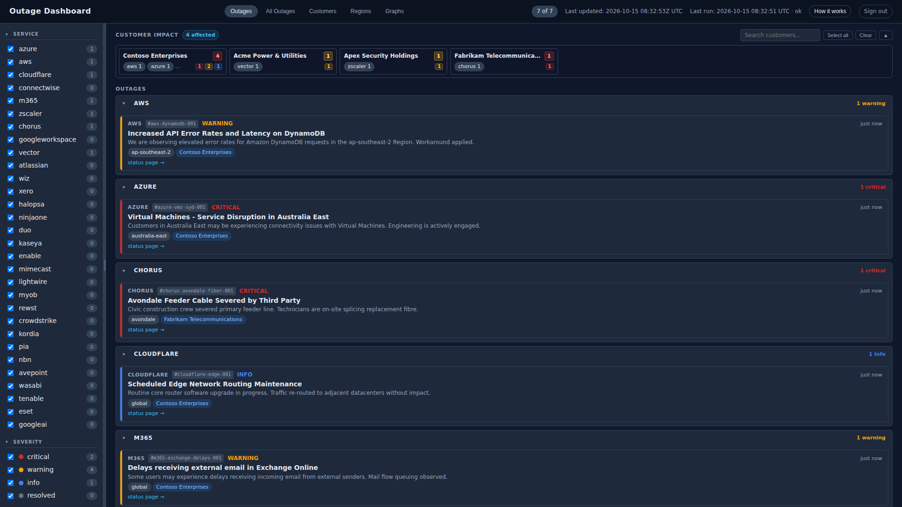
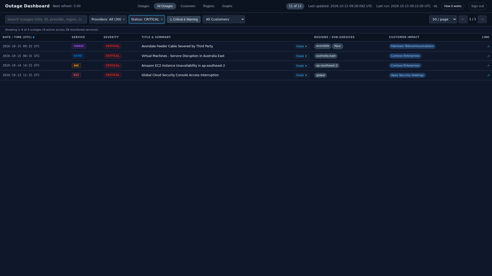
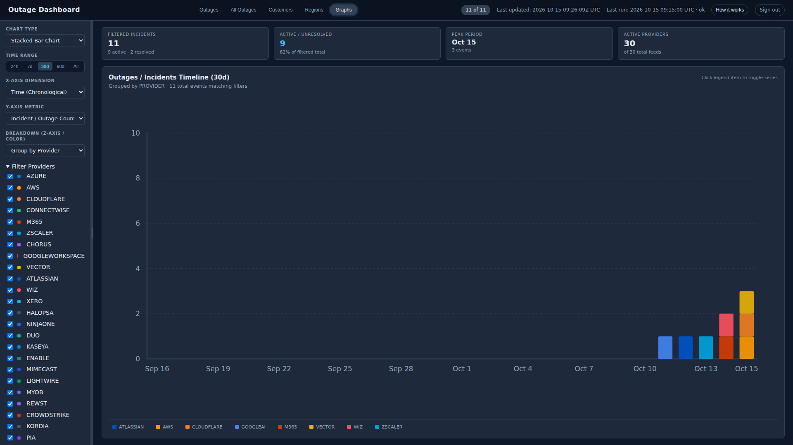
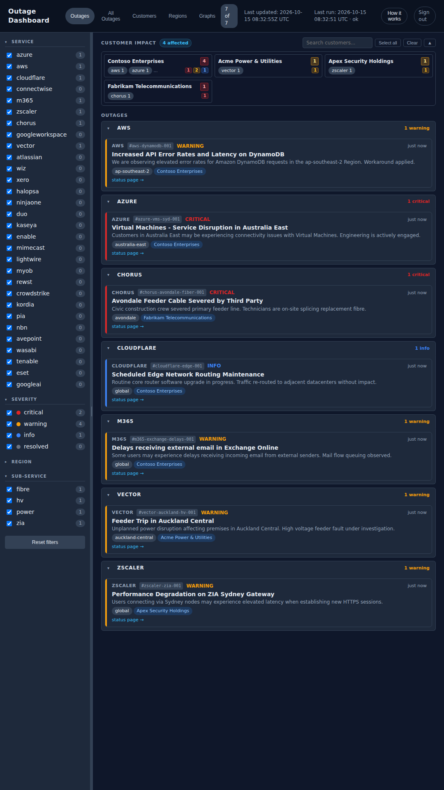
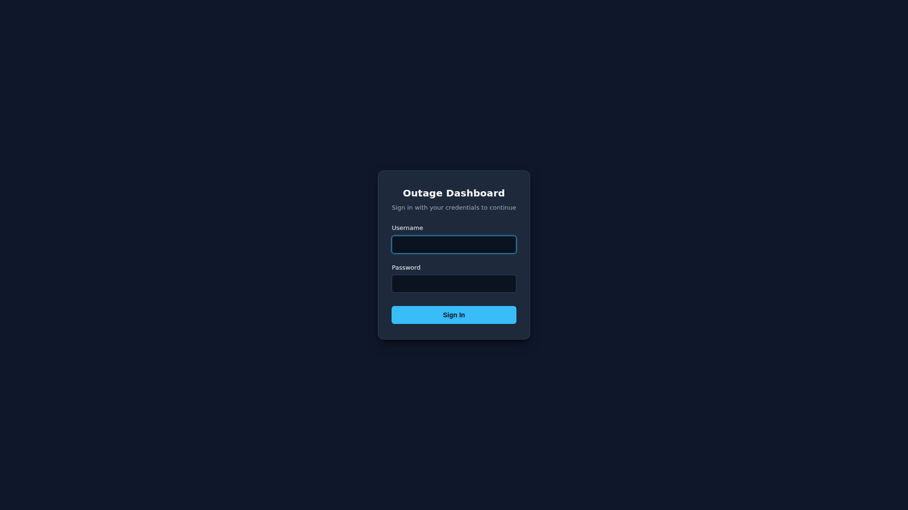

# Outage Dashboard

[](https://github.com/william-scholes/outage-dashboard/actions/workflows/test.yml)
[](https://www.python.org/)
[](https://opensource.org/licenses/MIT)

**Outage Dashboard** is a self-contained cloud and SaaS incident intelligence system. It polls status feeds from major cloud, telecommunications, and SaaS providers, standardizes outages into unified data models, matches incidents against customer regional subscriptions, and renders a live, responsive operations dashboard.

Pure Python standard library only. Zero third-party runtime package dependencies.

---

## Key Features

- **Zero External Dependencies:** Built entirely with the Python standard library. No `pip install`, no framework overhead, single binary feel.
- **Single-Writer Atomic Storage:** File-backed append-only event log (`events.ndjson`) and materialized active state (`alert_history.json`) with strict PID file locking and atomic swap writes.
- **Dynamic Customer Impact Matching:** Real-time in-memory matching of active outages against customer regional and sub-service subscriptions.
- **Live Web Dashboard:** Dark-mode responsive web interface with active outage filtering, customer subscription view, and approved region management.
- **Enterprise Security & Auth:**
  - Dedicated HTML `/login` page with browser password manager autofill support.
  - Cryptographically signed HMAC session cookies (`oa_session`).
  - Brute-force sliding window IP rate limiter with automatic lockout (HTTP 429).
  - Headless HTTP Basic Auth API support for monitoring tools and scripts.
  - Native TLS encryption with built-in 10-year SAN certificate generator and HTTP-to-HTTPS redirection.
- **Production-Ready Automation:** Systemd service units, 5-minute ingest timers, and automated encrypted Restic backups.

---

## Visual Dashboard Overview

| Desktop Dashboard (1080p) | All Outages (Critical Filter) |
| :---: | :---: |
|  |  |

| Analytics & Graphs View | Mobile Phone Display | Secure Form Login |
| :---: | :---: | :---: |
|  |  |  |

---

## Supported Providers

The platform monitors **30** cloud, telecom, MSP, and SaaS infrastructure feeds:

| Provider | Ingest Format | Adapter File | Default Feed / Source |
| :--- | :--- | :--- | :--- |
| **Atlassian** | Statuspage v2 (JSON) | `ingest/atlassian.py` | `https://confluence.status.atlassian.com/api/v2/incidents.json` |
| **AvePoint** | Custom (JSON) | `ingest/avepoint.py` | `https://identity.avepointonlineservices.com` |
| **AWS** | RSS 2.0 (XML) | `ingest/aws.py` | `https://status.aws.amazon.com/rss/all.rss` |
| **Azure** | RSS 2.0 (XML) | `ingest/azure.py` | `https://rssfeed.azure.status.microsoft/en-us/status/feed/` |
| **Chorus** | Custom (JSON) | `ingest/chorus.py` | `https://api.chorus.co.nz/events/v3/incidents` |
| **Cloudflare** | Statuspage v2 (JSON) | `ingest/cloudflare.py` | `https://www.cloudflarestatus.com/api/v2/incidents.json` |
| **ConnectWise** | Status.io (JSON) | `ingest/connectwise.py` | `https://api.status.io/1.0/status/619cf82551fec9053d612f09` |
| **CrowdStrike** | Custom OAuth2 (JSON) | `ingest/crowdstrike.py` | `https://api.crowdstrike.com/system-health/v1` |
| **Duo Security** | Statuspage v2 (JSON) | `ingest/duo.py` | `https://status.duo.com/api/v2/incidents.json` |
| **Enable Networks** | Statuspage v2 (JSON) | `ingest/enable.py` | `https://enable.statuspage.io/api/v2/incidents.json` |
| **ESET** | Statuspage v2 (JSON) | `ingest/eset.py` | `https://status.eset.com/api/v2/incidents.json` |
| **Google AI / Antigravity** | Custom (JSON) | `ingest/googleai.py` | `https://aistudio.google.com/status` |
| **Google Workspace** | Custom (JSON) | `ingest/googleworkspace.py` | `https://www.google.com/appsstatus/dashboard/incidents.json` |
| **HaloPSA** | Status.io (JSON) | `ingest/halopsa.py` | `https://api.status.io/1.0/status/63ef45da7ee94905308a1a4a` |
| **Kaseya (IT Glue / Datto)** | Statuspage v2 (JSON) | `ingest/kaseya.py` | `https://status.kaseya.com/api/v2/incidents.json` |
| **Kordia** | Custom (JSON) | `ingest/kordia.py` | `https://portal.kordia.co.nz/api/v1/network/incidents` |
| **Lightwire** | Custom (JSON) | `ingest/lightwire.py` | `https://status.lightwire.co.nz/api/v1/incidents` |
| **Microsoft 365** | Custom / RSS (XML) | `ingest/m365.py` | `https://status.cloud.microsoft/api/feed/mac` |
| **Mimecast** | Status.io (JSON) | `ingest/mimecast.py` | `https://api.status.io/1.0/status/5d849b1c02e65b3ec45369d4` |
| **MYOB** | Custom (JSON) | `ingest/myob.py` | `https://status.myob.com/api/blocks/calendar/v1` |
| **NBN Co** | Custom (JSON) | `ingest/nbn.py` | `https://www.nbnco.com.au/api/v1/network-status` |
| **NinjaOne** | Statuspage v2 (JSON) | `ingest/ninjaone.py` | `https://status.ninjaone.com/api/v2/incidents.json` |
| **Pia (aiDesk)** | Custom (JSON) | `ingest/pia.py` | `https://api.pia.ai/v1/health` |
| **Rewst** | Custom (JSON) | `ingest/rewst.py` | `https://status-au.rewst.io` |
| **Tenable** | Statuspage v2 (JSON) | `ingest/tenable.py` | `https://status.tenable.com/api/v2/incidents.json` |
| **Vector** | Custom (JSON) | `ingest/vector.py` | `https://outage-centre.api.vector.co.nz/v1/outages` |
| **Wasabi** | Statuspage v2 (JSON) | `ingest/wasabi.py` | `https://status.wasabi.com/api/v2/incidents.json` |
| **Wiz** | RSS 2.0 (XML) | `ingest/wiz.py` | `https://status.wiz.io/history.rss` |
| **Xero** | Statuspage v2 (JSON) | `ingest/xero.py` | `https://status.xero.com/api/v2/incidents.json` |
| **Zscaler** | RSS 2.0 (XML) | `ingest/zscaler.py` | `https://trust.zscaler.com/rss-feed` |

---

## Quick Start (Local)

```bash
# 1. Clone repository
git clone https://github.com/william-scholes/outage-dashboard.git
cd outage-dashboard

# 2. Initialize local state directory (creates empty state/customers.json)
python3 python_system/run.py init

# (Optional) Seed demo customer subscriptions to test customer impact matching:
cp python_system/examples/customers.json python_system/state/customers.json

# 3. Pull live data from all registered providers
python3 python_system/run.py run-all

# 4. Start local development dashboard (unauthenticated on 127.0.0.1)
python3 python_system/run.py serve
# Open http://127.0.0.1:8765/ in your browser (add/edit customers directly in the UI)
```

---

## CLI Command Reference

All subcommands are accessible via `python3 python_system/run.py <command>` or `./python_system/bin/oa <command>`:

| Command | Description |
| :--- | :--- |
| `init` | Create seed state directory and empty state files. |
| `run-all [--skip-apply]` | Fetch from all registered providers, normalize, and update state. |
| `ingest <provider> [--apply]` | Ingest a single provider feed and optionally merge into state. |
| `serve [--ssl] [--port P]` | Start the dashboard web and API server. |
| `generate-cert [--host H]` | Generate 10-year self-signed TLS SAN certificate for HTTPS. |
| `status` | Display summary of tracked outages, customers, and last ingest run. |
| `dashboard-data` | Output current customer impact matrix in JSON format. |
| `lint-customers` | Validate `customers.json` against `approved-regions.csv`. |
| `lint-events` | Lint active event records for schema consistency and timestamp validity. |
| `verify-fixtures` | Validate recorded test fixtures against current parser adapters. |

## Documentation Index

- 🤝 **[Contributing Guidelines](CONTRIBUTING.md):** Code standards, adding new cloud adapters, and pull request checklist.
- 📐 **[System Architecture](docs/ARCHITECTURE.md):** Detailed design of storage engine, customer matcher, and concurrency model.
- 🚀 **[Production Deployment](docs/DEPLOYMENT.md):** Guide for deploying systemd services, timers, TLS, and automated backups on Linux.
- 💻 **[Local Development](docs/DEVELOPMENT.md):** Setup instructions, unit test workflows, and adding new provider adapters.
- 🛠️ **[Troubleshooting & Runbook](docs/TROUBLESHOOTING.md):** Diagnostic commands, lock recovery, rate limit resets, and certificate management.

---

## Contributing

Contributions are welcome! Please read our **[Contributing Guidelines](CONTRIBUTING.md)** before submitting pull requests or proposing new provider adapters.

---

## License

This project is licensed under the MIT License - see the [LICENSE](LICENSE) file for details.
