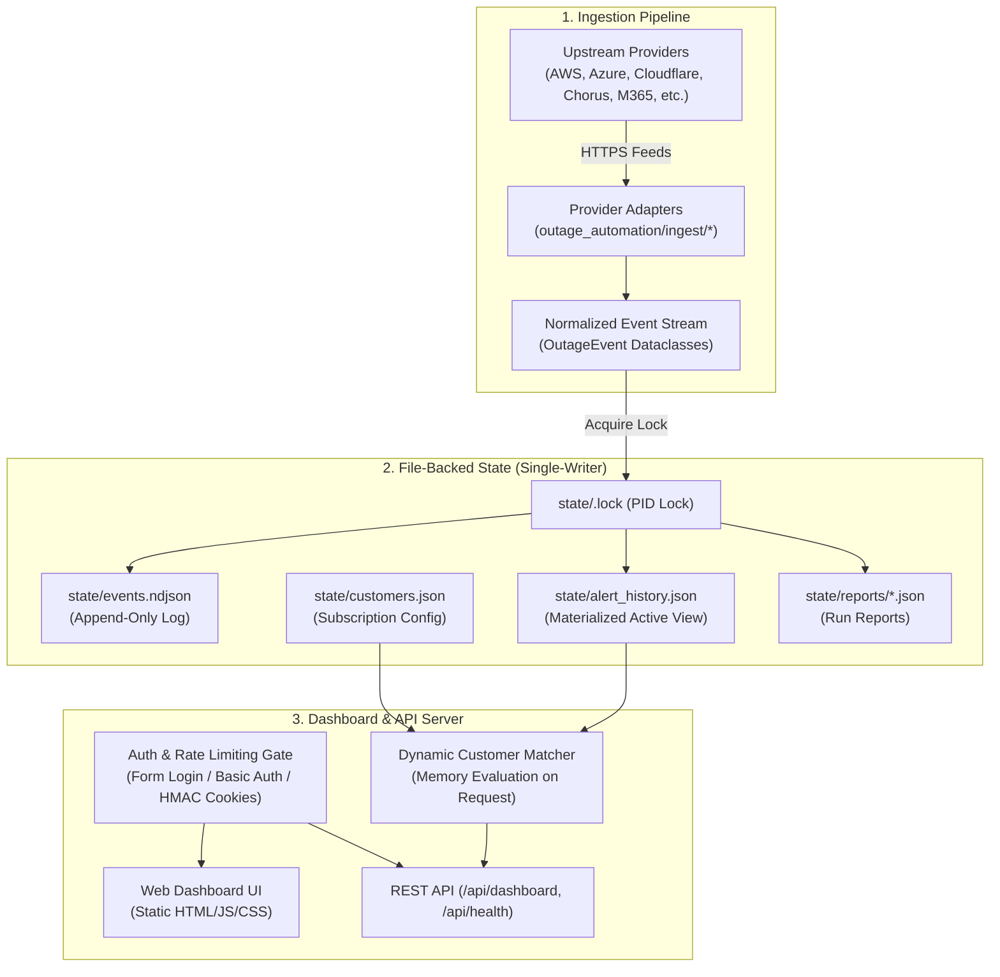

# System Architecture & Technical Specification

**Outage Automation** is a lightweight, self-contained cloud and SaaS incident monitoring pipeline with a live web dashboard. It is written in pure Python (standard library only) and relies on single-writer, file-backed atomic state.

---

## 1. High-Level Data Flow



---

## 2. Ingestion & Normalization

1. **Scheduled Execution:** A systemd timer (`outage-automation.timer`) or CLI invocation triggers `oa-run-all.sh` every 5 minutes.
2. **Provider Adapters:** Each provider adapter fetches raw upstream JSON/XML/RSS payloads and transforms them into standardized `OutageEvent` dataclasses.
3. **Deduplication & Materialization:**
   - Raw IDs (`raw_id`) uniquely identify incidents.
   - Updates to active incidents (status changes, updates, resolution) overwrite existing records in `alert_history.json`.
   - All historical events are appended sequentially to `events.ndjson`.
4. **Data Retention & TTL:**
   - Active outages persist until resolved.
   - Resolved outages age out after `OA_TTL_DAYS` (default: 7 days) and are purged from `alert_history.json`.

---

## 3. Storage & Concurrency Model

- **Zero Database Server:** Operates entirely using standard POSIX file I/O and JSON/NDJSON files.
- **Single-Writer Concurrency:** A file-based locking mechanism (`state/.lock`) ensures only one process writes to the state directory at any given time.
  - The lock file records the holding process's PID and timestamp.
  - Stale locks (from aborted or killed processes) are detected and cleaned up automatically.
- **Atomic File Writes:** Writes to state files use the tempfile replacement pattern:
  ```python
  tmp_path = path.with_suffix(".tmp")
  with open(tmp_path, "w", encoding="utf-8") as f:
      json.dump(data, f)
  os.replace(tmp_path, path)
  ```
  This guarantees that readers (the dashboard server) never observe partially-written JSON files.

---

## 4. Customer Matching Engine

Customer matching is evaluated **dynamically in memory** at request time rather than hardcoded into storage:

```
Customer Impact Rule:
Customer is Impacted IF:
  (Event.Service == Customer.SubscribedService)
  AND
  (Event.Region is Empty OR Event.Region == 'global' OR Event.Region IN Customer.SubscribedRegions)
  AND
  (Customer.SubServices is Empty OR Event.SubService is Empty OR Event.SubService IN Customer.SubServices)
```

This decoupled design means adding, removing, or editing customer subscriptions takes effect immediately without needing to rewrite past event records.

---

## 5. Security & Authentication Architecture

### Authentication Layers
1. **Loopback Bypass:** When bound to `127.0.0.1`, requests are permitted without authentication (simplifies local development and testing).
2. **Non-Loopback Hard Gate:** The server **refuses to start** on public/LAN interfaces (`0.0.0.0`, specific network IPs) unless authentication credentials are configured.
3. **Session Cookies & Form Login:**
   - Browser navigation to `/` or `/dashboard` redirects unauthenticated users to `/login`.
   - On successful authentication, the server issues an `oa_session` cookie signed with an in-memory HMAC-SHA256 secret.
4. **HTTP Basic Auth API Compatibility:** Headless API clients, monitoring probes, and CLI scripts can supply credentials via standard `Authorization: Basic ...` headers.
5. **Health Liveness Probe:** `/api/health` remains open without authentication for uptime monitors and load balancers.

### Brute-Force Rate Limiting & Lockout
- In-memory sliding window rate limiter tracks failed authentication attempts per IP address.
- Configuration via environment variables:
  - `OA_AUTH_MAX_FAILURES` (default: `5` attempts)
  - `OA_AUTH_FAIL_WINDOW` (default: `60` seconds)
  - `OA_AUTH_LOCKOUT_SECONDS` (default: `900` seconds / 15 minutes)
- Locked out IPs receive `HTTP 429 Too Many Requests` with a `Retry-After: <seconds>` response header.

### Native TLS / HTTPS
- Built-in TLS server context via Python stdlib `ssl.SSLContext(ssl.PROTOCOL_TLS_SERVER)`.
- TLS 1.2 minimum protocol version enforcement (`ssl.TLSVersion.TLSv1_2`).
- Self-signed 10-year SAN certificate generation CLI (`oa generate-cert`).
- Optional HTTP-to-HTTPS redirect server running concurrently on a secondary port (`--redirect-port`).
